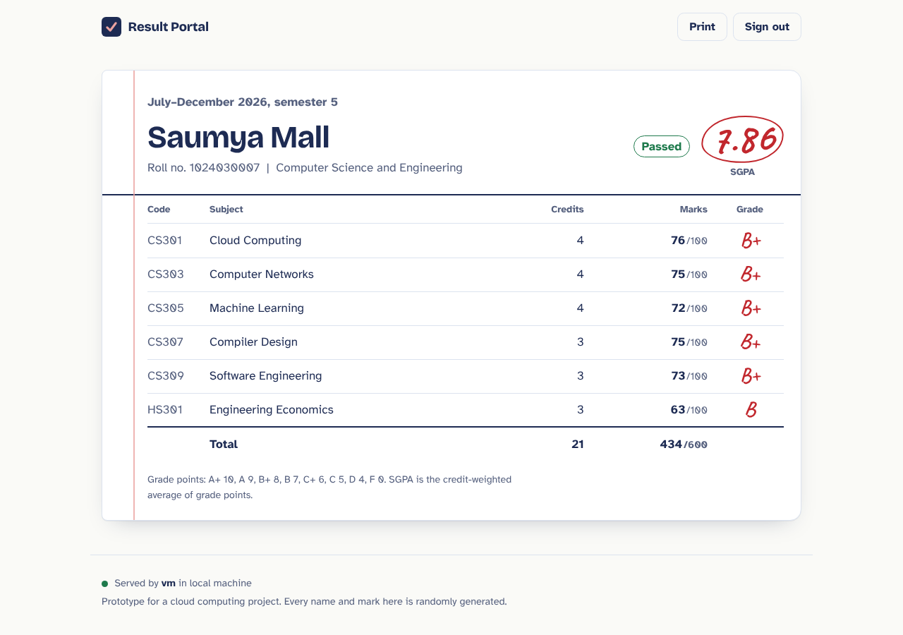

# Elastic Auto-Scaling of a Cloud-Hosted Examination Result Portal

A complete, working version of the project: the result website, the full AWS
setup written as Terraform code, a 5,000-student load test, and scripts that
measure everything and draw the graphs for your report.

> New to all of this? Read **[docs/HOW_IT_WORKS.md](docs/HOW_IT_WORKS.md)**
> first. It explains every part in plain words and has viva questions with
> answers. This README is the step-by-step "what to type" guide.



More screens: [sign in](docs/screenshots/sign-in.png),
[phone](docs/screenshots/marksheet-phone.png),
[dark mode](docs/screenshots/marksheet-dark.png),
[admin](docs/screenshots/admin.png).

---

## What's in this folder

| Folder | What it is | Language |
|---|---|---|
| `app/` | The result portal website (login, marksheet, admin page) and the fake-data generator | Python (Flask) |
| `terraform/` | The entire AWS setup: network, firewalls, database, load balancer, auto scaling, dashboard, load-test machines | Terraform |
| `loadtest/` | The fake 5,000-student rush | Python (Locust) |
| `analysis/` | Records each experiment, downloads CloudWatch data, draws the graphs | Python |
| `docs/` | Plain-language explanation and viva prep | — |

---

## Part A: Run it on your laptop first (no AWS, no cost)

This proves the website works before you touch the cloud.

### A1. Install the tools

- **Python 3.11 or newer** from python.org (on Windows, tick *Add python.exe to PATH*)
- **Git** from git-scm.com
- **VS Code** from code.visualstudio.com

Check in a terminal: `python --version` and `git --version`.
(On Mac/Linux, type `python3` wherever this guide says `python`.)

### A2. Start the website

Open a terminal **inside this project folder**, then:

```bash
cd app
python -m venv .venv
```

Activate the virtual environment (a private box for this project's libraries):

- Windows: `.venv\Scripts\activate`
- Mac/Linux: `source .venv/bin/activate`

Then:

```bash
pip install -r requirements.txt
python seed.py --count 500 --publish
python app.py
```

`seed.py` creates `local.db` (a small database file) with 500 fake students and
publishes their results. Locally the app uses SQLite, so you don't need MySQL.

Open **http://127.0.0.1:5000** and sign in with roll number `1024030001`,
password `1024030001`. Then try **http://127.0.0.1:5000/admin** (password
`admin123` locally) and hide/publish the results.

### A3. Try a tiny load test locally (optional)

In a **second** terminal (keep the website running in the first):

```bash
cd loadtest
python -m venv .venv
.venv\Scripts\activate          # Mac/Linux: source .venv/bin/activate
pip install -r requirements.txt
locust -f locustfile.py --host http://127.0.0.1:5000 --class-picker
```

Open **http://localhost:8089**, choose user class **Student** and shape
**SmokeTest**, and press **Start**. You'll see live response times. Your laptop
can't simulate 5,000 users; that's what the cloud load generators are for.

---

## Part B: Put the code on GitHub

New cloud servers download the website code from GitHub when they boot, so
the repository must be **public**. No passwords are stored in the code.

1. On github.com, create a new **public** repository called `result-portal`
   (don't add a README; this folder already has one).
2. In a terminal inside this project folder:

```bash
git init
git add .
git commit -m "Result portal cloud project"
git branch -M main
git remote add origin https://github.com/YOUR-USERNAME/result-portal.git
git push -u origin main
```

Every time you change the app, `git push` again. New servers always pull the latest code.

---

## Part C: Build it on AWS

### C1. Get AWS access

- **AWS Academy Learner Lab (best):** ask your faculty. It gives free credit
  and can't produce a surprise bill. Start the lab, click **AWS Details →
  Show** next to *AWS CLI*, and paste the text into the file
  `~/.aws/credentials` (Windows: `C:\Users\YOU\.aws\credentials`). These
  credentials expire when the lab session ends; paste fresh ones each session.
  Use region `us-east-1`.
- **Personal AWS account:** create an IAM user with access keys, run
  `aws configure`, and use region `ap-south-1` (Mumbai). Set `budget_email`
  in step C3 so AWS emails you before spending gets out of hand.

### C2. Install the cloud tools

- **AWS CLI v2** (search "install AWS CLI v2"). Check: `aws sts get-caller-identity` prints your account.
- **Terraform** from developer.hashicorp.com/terraform/install. Check: `terraform -version`.

### C3. Fill in your settings

```bash
cd terraform
copy terraform.tfvars.example terraform.tfvars      # Mac/Linux: cp
```

Open `terraform.tfvars` in VS Code and set at least:

- `app_repo_url`: your GitHub repository from Part B
- `admin_password`: letters and digits, 8 or more
- `region`: `us-east-1` for Learner Lab, `ap-south-1` for a personal account
- `my_ip_cidr`: search "what is my ip", then write it like `"49.36.12.34/32"`

`terraform.tfvars` is in `.gitignore`, so it never goes to GitHub.

### C4. Build everything

```bash
terraform init
terraform apply
```

Type `yes` when asked. The first build takes **10–15 minutes** (the database
is the slowest part). At the end Terraform prints some outputs:

- `portal_url`: your live website
- `admin_url`: publish/hide results
- `dashboard_url`: the CloudWatch dashboard

Wait another **3–5 minutes** for the servers to install the app and fill the
database. Then open `portal_url`, sign in as `1024030001` / `1024030001`, and
refresh a few times. The footer shows which server answered. **Watching it
change between servers is the load balancer working.**

Open `admin_url`, sign in with your admin password and click **Publish results**.

### C5. Stop paying when you're done for the day

```bash
terraform destroy
```

Type `yes`. **Do this at the end of every session.** The load balancer and
database cost money every hour they exist, even when nobody is using them.
You can rebuild everything later with `terraform apply`.

---

## Part D: Run the experiments

### D1. One-time setup on your laptop

```bash
cd analysis
python -m venv .venv
.venv\Scripts\activate          # Mac/Linux: source .venv/bin/activate
pip install -r requirements.txt
```

These scripts use the same AWS credentials as Terraform.

### D2. Do a dry run first

```bash
cd terraform
terraform apply -var strategy=fixed_minimal -var loadgen_workers=3
```

Open `locust_url` (printed by Terraform; give it about 3 minutes to boot).
Choose **Student** and **SmokeTest**, press **Start**. If the numbers look
sensible and the failure count stays near zero, everything is wired up.

### D3. The real experiment loop

Run each strategy **2–3 times**. For every run:

**1. Switch strategy and start the load generators.** Run from the `terraform` folder:

```bash
terraform apply -var strategy=reactive -var loadgen_workers=3
```

Strategies: `fixed_minimal`, `reactive`, `scheduled`, `over_provisioned`,
and the "best practice" bonus `scheduled_reactive`.
Applying also resets the group to its starting size, so every run begins the same way.

**2. Start recording.** In a second terminal, from the `analysis` folder:

```bash
python monitor.py --name reactive-run1
```

**3. Start the burst.** On the Locust page choose **Student** and
**ResultDayBurst**, then press **Start**. The test lasts 20 minutes:

| Minutes | What happens |
|---|---|
| 0–1 | Quiet: about 2% of students online |
| 1–3 | The burst: 5,000 students arrive within 2 minutes |
| 3–18 | Everyone stays and keeps refreshing |
| 18–20 | Students leave |

Keep the CloudWatch dashboard open and watch the servers react.
`monitor.py` stops by itself about a minute after Locust finishes.

**4. Wait 5 minutes, then download the CloudWatch data:**

```bash
python fetch_cloudwatch.py --name reactive-run1
```

**For `scheduled` and `scheduled_reactive` only:** the pretend result-release
time is **20 minutes after** `terraform apply`, and servers are added 10
minutes before it. Terraform prints `release_time_ist`. Start `monitor.py`
right after `apply`, then press **Start** in Locust at the release time.

A good order that keeps costs down: `fixed_minimal` → `reactive` →
`scheduled` → `scheduled_reactive` → `over_provisioned`.

### D4. Make the graphs

```bash
python analyze.py
```

Everything lands in `results/report/`: six PNG charts, `summary.csv`, and
`summary.md` (a ready-made table for your report). See
[docs/HOW_IT_WORKS.md](docs/HOW_IT_WORKS.md#reading-your-results) for how to read them.

---

## Part E: The "best possible version" upgrades

Do these only after the four main strategies are recorded. Each is one setting.

| Upgrade | How | What it shows |
|---|---|---|
| Scheduled + reactive | `-var strategy=scheduled_reactive` | Plan for the known peak, keep an alarm as a safety net. This is what a real team would run. |
| Warm pool | `-var enable_warm_pool=true` with `strategy=reactive` | New servers come from a pool of already-booted, stopped servers, which removes most of the start-up delay. Compare its scale-out bar with plain reactive. |
| Cache | `-var app_cache_seconds=60` | Each server remembers published marksheets for 60 s, so the database is asked far less often. Compare database CPU before and after. This fixes the bottleneck your project identifies. |

Name the runs so the charts stay readable, for example
`python monitor.py --name reactive-warmpool-run1`.

---

## Troubleshooting

| Problem | Likely cause and fix |
|---|---|
| `portal_url` shows **502 Bad Gateway** | Servers are still installing (wait 5 minutes). If it persists, open EC2 → Instances → select a server → *Actions → Monitor and troubleshoot → Get system log*, and look for the error near the end. Usually the GitHub URL is wrong or the repository is private. |
| Sign-in says the roll number and password don't match | The first server is still creating the 5,000 students (about 1–2 minutes). |
| New servers never appear during the reactive test | EC2 → Auto Scaling Groups → *result-portal-asg* → **Activity**. Learner Lab limits how many instances can run at once. Lower `max_servers` (e.g. 6) and `loadgen_workers` (e.g. 2), and say so in your report. |
| `terraform apply` fails with *start time is in the past* | Happens with scheduled strategies when the apply takes too long (usually the very first build). Run `terraform apply` again, or build once with `fixed_minimal` first. |
| Credentials errors in Learner Lab | The lab session expired. Start it again and paste fresh credentials. |
| Locust page doesn't open | `my_ip_cidr` doesn't match your current IP (it changes on mobile data and hostel Wi-Fi). Update it and `terraform apply` again. |
| Locust workers use 100% CPU | They are the bottleneck, not your servers. Add a worker (`loadgen_workers=4`). |

---

## Honest limitations (mention these in your report)

- The site uses plain **HTTP**. HTTPS needs a domain name and a certificate (AWS Certificate Manager); the scaling results are unaffected.
- Web servers have public IP addresses so they can download code without a paid NAT Gateway. Their firewall still accepts traffic only from the load balancer.
- One database instance, no replicas: deliberately, since showing it as the bottleneck is part of the result.
- Cost figures in `analyze.py` use approximate on-demand prices. Check the AWS pricing page for your region and pass `--price`.
